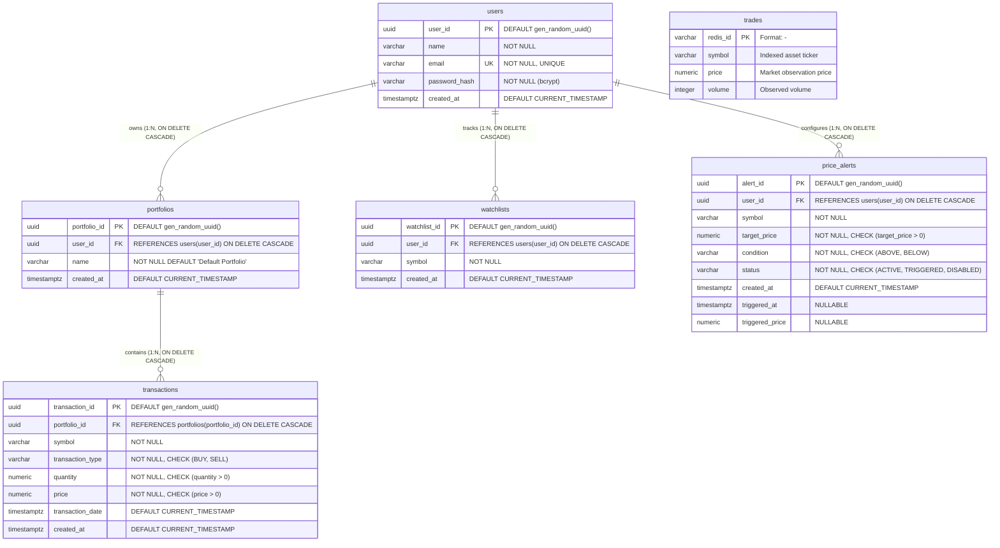

# MarketWise — DBMS Mini-Project

A stream-buffered stock market data pipeline, portfolio management ledger, and time-series analytical dashboard. MarketWise demonstrates modern Database Management System (DBMS) principles: in-memory streaming ingestion decoupling, relational data modeling, ACID transactions with row-level locking, foreign key referential integrity with cascading deletes, bcrypt password hashing, signed JWT authorization, database-backed persistent watchlists, real-time price alerts, and weighted average cost (WAC) portfolio accounting.

---

## 1. Project Overview & DBMS Objectives

In financial data architectures, high-frequency market updates can easily overwhelm transactional databases if written synchronously. Furthermore, investor applications require strict transactional guarantees, preventing invalid states like negative equity balances, orphaned transactions, or unauthorized cross-tenant data access.

**MarketWise** demonstrates:
1. **Decoupled Stream Buffering**: Redis Streams ingests and buffers high-frequency ticks, preventing database write starvation.
2. **Relational Schema Design & Constraints**: Normalized tables (`users`, `portfolios`, `transactions`, `watchlists`, `price_alerts`, `trades`) enforcing primary keys, foreign keys (`ON DELETE CASCADE`), unique constraints, and check constraints (`quantity > 0`, `price > 0`, `BUY`/`SELL`, `target_price > 0`).
3. **Concurrency Control & ACID Transactions**: Row-level locking (`SELECT ... FOR UPDATE`) prevents race conditions and over-selling in concurrent trade executions.
4. **Weighted Average Cost (WAC) Financial Accounting**: Computes cost basis, realized gains, and live unrealized P&L joined against latest market ticks.
5. **Secure Authentication & Ownership Isolation**: Bcrypt salted password hashing (rounds=12) and stateless HMAC-SHA256 JWT tokens ensuring user-level data isolation.
6. **Automated Price Alerts**: Event-driven threshold tracking evaluating incoming ticks against user-configured price boundaries (`ABOVE`/`BELOW`).

---

## 2. Architecture & Data Flow

```text
Yahoo Finance (yfinance API)
       │ (Polls 10 NIFTY 50 quotes every 5s)
       ▼
Python Producer (`producer/producer.py`)
       │ Redis XADD (Stream: "trades", Payload: symbol, price, volume)
       ▼
Redis Streams Broker (`stock-redis`, Port 6380:6379)
       │ Redis XREAD (Blocking consumer loop)
       ▼
Python Consumer (`consumer/consumer.py`)
       │ SQL INSERT (idempotent primary key redis_id)
       ▼
PostgreSQL 16 / TimescaleDB (`stock-timescaledb`, Port 5433:5432)
  ├── Table: trades (Market Observations)
  ├── Table: users (Authentication & Profiles)
  ├── Table: portfolios (User Investment Accounts)
  ├── Table: transactions (Buy / Sell Trade Ledger)
  ├── Table: watchlists (User Stock Tracking)
  └── Table: price_alerts (Threshold Alert Engine)
       ▲
       │ Parameterized SQL queries (ACID Transactions, FOR UPDATE, DISTINCT ON)
       ▼
FastAPI REST Server (`stock-api`, Port 8000:8000)
  ├── Public Endpoints: /stocks, /stocks/{symbol}/history, /auth/register, /auth/login
  └── Protected Endpoints: /auth/me, /portfolio, /portfolio/transactions, /watchlist, /alerts
       ▲
       │ HTTP REST / JSON (JWT Bearer Auth, CORS enabled)
       ▼
React + TypeScript Frontend Client (Vite Dev Server, Port 5173 / 5174)
  ├── Market Dashboard View (Live Chart, Technical Insights, Watchlist/Waitlist)
  ├── Portfolio Management View (Valuation, Holdings Table, Trade Form, Ledger)
  └── Price Alerts Modal (Configurable Thresholds & Status Tracking)
```

---

## 3. Database Schema & Entity-Relationship (ER) Diagram

### Mermaid ER Diagram



### Table Specifications & Constraints

#### 1. `public.users`
Stores user credentials and profile information.
- `user_id` (`UUID PRIMARY KEY DEFAULT gen_random_uuid()`): Unique identifier.
- `name` (`VARCHAR(100) NOT NULL`): User's display name.
- `email` (`VARCHAR(255) NOT NULL UNIQUE`): Unique normalized email address. Indexed via `idx_users_email`.
- `password_hash` (`VARCHAR(255) NOT NULL`): Salted bcrypt hash (rounds=12). Plaintext passwords are never stored.
- `created_at` (`TIMESTAMP WITH TIME ZONE DEFAULT CURRENT_TIMESTAMP`).

#### 2. `public.portfolios`
Represents an investment account belonging to a registered user.
- `portfolio_id` (`UUID PRIMARY KEY DEFAULT gen_random_uuid()`): Unique portfolio identifier.
- `user_id` (`UUID NOT NULL REFERENCES public.users(user_id) ON DELETE CASCADE`): Foreign key establishing ownership. Indexed via `idx_portfolios_user_id`.
- `name` (`VARCHAR(100) NOT NULL DEFAULT 'Default Portfolio'`).
- `created_at` (`TIMESTAMP WITH TIME ZONE DEFAULT CURRENT_TIMESTAMP`).

#### 3. `public.transactions`
Immutable financial ledger recording buy and sell transactions.
- `transaction_id` (`UUID PRIMARY KEY DEFAULT gen_random_uuid()`).
- `portfolio_id` (`UUID NOT NULL REFERENCES public.portfolios(portfolio_id) ON DELETE CASCADE`): Foreign key link. Indexed via `idx_transactions_portfolio_id`.
- `symbol` (`VARCHAR(20) NOT NULL`): Tracked ticker symbol (e.g., `RELIANCE.NS`). Indexed via `idx_transactions_symbol`.
- `transaction_type` (`VARCHAR(4) NOT NULL CHECK (transaction_type IN ('BUY', 'SELL'))`): Transaction action constraint.
- `quantity` (`NUMERIC(12, 4) NOT NULL CHECK (quantity > 0)`): Number of shares traded. Must be strictly positive.
- `price` (`NUMERIC(12, 2) NOT NULL CHECK (price > 0)`): Transaction price per share. Must be strictly positive.
- `transaction_date` (`TIMESTAMP WITH TIME ZONE DEFAULT CURRENT_TIMESTAMP`): Execution timestamp.
- `created_at` (`TIMESTAMP WITH TIME ZONE DEFAULT CURRENT_TIMESTAMP`).

#### 4. `public.watchlists`
Database-backed persistent watchlists for authenticated users.
- `watchlist_id` (`UUID PRIMARY KEY DEFAULT gen_random_uuid()`).
- `user_id` (`UUID NOT NULL REFERENCES public.users(user_id) ON DELETE CASCADE`).
- `symbol` (`VARCHAR(20) NOT NULL`).
- `created_at` (`TIMESTAMP WITH TIME ZONE DEFAULT CURRENT_TIMESTAMP`).
- Constraint: `UNIQUE (user_id, symbol)` prevents duplicate entries per user. Indexed via `idx_watchlists_user_id` and `idx_watchlists_user_symbol`.

#### 5. `public.price_alerts`
Real-time database-backed price alert configurations and trigger state.
- `alert_id` (`UUID PRIMARY KEY DEFAULT gen_random_uuid()`).
- `user_id` (`UUID NOT NULL REFERENCES public.users(user_id) ON DELETE CASCADE`).
- `symbol` (`VARCHAR(20) NOT NULL`).
- `target_price` (`NUMERIC(12, 2) NOT NULL CHECK (target_price > 0)`).
- `condition` (`VARCHAR(10) NOT NULL CHECK (condition IN ('ABOVE', 'BELOW'))`).
- `status` (`VARCHAR(20) NOT NULL DEFAULT 'ACTIVE' CHECK (status IN ('ACTIVE', 'TRIGGERED', 'DISABLED'))`).
- `created_at` (`TIMESTAMP WITH TIME ZONE DEFAULT CURRENT_TIMESTAMP`).
- `triggered_at` (`TIMESTAMP WITH TIME ZONE DEFAULT NULL`).
- `triggered_price` (`NUMERIC(12, 2) DEFAULT NULL`).
- Indexed via `idx_price_alerts_user_id`, `idx_price_alerts_symbol_status`, and `idx_price_alerts_user_status`.

#### 6. `public.trades`
Raw market tick observations ingested from Redis Streams.
- `redis_id` (`VARCHAR(30) PRIMARY KEY`): Stream ID (`<epoch_ms>-<seq>`), guaranteeing idempotent ingestion.
- `symbol` (`VARCHAR(20)`), `price` (`NUMERIC(10,2)`), `volume` (`INTEGER`).

---

## 4. Portfolio Accounting & Business Logic

Holdings and financial metrics are computed dynamically from the transaction ledger:

### 1. Weighted Average Cost (WAC) Method
- **BUY Transaction**:
  $$\text{New Cost Basis} = \frac{(\text{Prev Qty} \times \text{Prev Avg Cost}) + (\text{Buy Qty} \times \text{Buy Price})}{\text{Prev Qty} + \text{Buy Qty}}$$
- **SELL Transaction**:
  $$\text{Realized P\&L} = (\text{Sell Price} - \text{Current Avg Cost}) \times \text{Sold Qty}$$
  The remaining shares retain the existing average cost basis. When holding quantity reaches zero, average cost basis resets to zero.

### 2. Live Market Valuation
- **Current Market Value**: $\text{Held Quantity} \times \text{Latest Market Price}$ (queried via `DISTINCT ON (symbol)` from `trades`).
- **Unrealized P&L**: $\text{Current Market Value} - (\text{Held Quantity} \times \text{Avg Cost})$.
- **Return Percentage**: $\frac{\text{Unrealized P\&L}}{\text{Invested Cost}} \times 100\%$.

### 3. Concurrency Control & Deletion Integrity
- **Row-Level Locking**: When recording transactions, `SELECT portfolio_id FROM portfolios WHERE ... FOR UPDATE;` prevents concurrent operations from causing negative balances.
- **Over-selling Rejection**: A SELL transaction is rejected with HTTP 400 if requested quantity exceeds available balance ($\sum \text{BUY} - \sum \text{SELL}$).
- **Safe Transaction Deletion**: Deleting a BUY transaction verifies that the removal will not cause running balance to drop below zero at any point during subsequent SELLs. If dependent sales exist, the deletion is aborted with HTTP 400.

---

## 5. REST API Documentation

Base URL: `http://localhost:8000` (Swagger UI: `http://localhost:8000/docs`)

### Authentication Endpoints

| Method | Endpoint | Description | Status Codes |
| :--- | :--- | :--- | :--- |
| `POST` | `/auth/register` | Register a new user and create default portfolio | `201 Created`, `400 Bad Request`, `409 Conflict` |
| `POST` | `/auth/login` | Authenticate user and issue signed JWT token | `200 OK`, `401 Unauthorized` |
| `GET` | `/auth/me` | Fetch authenticated user profile (Bearer token required) | `200 OK`, `401 Unauthorized` |

### Portfolio Endpoints

| Method | Endpoint | Description | Status Codes |
| :--- | :--- | :--- | :--- |
| `GET` | `/portfolio` | Retrieve user portfolio summary and calculated holdings | `200 OK`, `401 Unauthorized` |
| `POST` | `/portfolio/transactions` | Record a BUY or SELL transaction with balance checks | `201 Created`, `400 Bad Request`, `401 Unauthorized` |
| `GET` | `/portfolio/transactions` | Retrieve user transaction history ordered by date | `200 OK`, `401 Unauthorized` |
| `DELETE` | `/portfolio/transactions/{id}`| Safely delete a transaction with balance validation | `200 OK`, `400 Bad Request`, `403 Forbidden`, `404 Not Found` |

### Watchlist Endpoints

| Method | Endpoint | Description | Status Codes |
| :--- | :--- | :--- | :--- |
| `GET` | `/watchlist` | Retrieve user's database-backed persistent watchlist | `200 OK`, `401 Unauthorized` |
| `POST` | `/watchlist` | Add stock symbol to watchlist (duplicate-safe) | `201 Created`, `400 Bad Request`, `401 Unauthorized` |
| `DELETE` | `/watchlist/{symbol}` | Remove stock symbol from user's watchlist | `200 OK`, `401 Unauthorized`, `404 Not Found` |
| `GET` | `/watchlist/{symbol}/check` | Check if stock symbol is currently in user's watchlist | `200 OK`, `401 Unauthorized` |
| `POST` | `/watchlist/sync` | Sync/migrate client-side watchlist entries into database | `200 OK`, `401 Unauthorized` |

### Price Alerts Endpoints

| Method | Endpoint | Description | Status Codes |
| :--- | :--- | :--- | :--- |
| `POST` | `/alerts` | Create a new price alert (`ABOVE`/`BELOW`) with immediate threshold check | `201 Created`, `400 Bad Request`, `401 Unauthorized` |
| `GET` | `/alerts` | Retrieve user's active and triggered price alerts | `200 OK`, `401 Unauthorized` |
| `GET` | `/alerts/{id}` | Retrieve specific alert details with ownership verification | `200 OK`, `401 Unauthorized`, `403 Forbidden`, `404 Not Found` |
| `PATCH` | `/alerts/{id}/disable` | Disable an active alert | `200 OK`, `401 Unauthorized`, `403 Forbidden`, `404 Not Found` |
| `DELETE` | `/alerts/{id}` | Delete an alert with ownership verification | `200 OK`, `401 Unauthorized`, `403 Forbidden`, `404 Not Found` |

### Market Endpoints

| Method | Endpoint | Description | Status Codes |
| :--- | :--- | :--- | :--- |
| `GET` | `/stocks` | Retrieve latest price for all 10 tracked symbols | `200 OK`, `500 Server Error` |
| `GET` | `/stocks/{symbol}/history` | Retrieve up to 100 latest points chronologically | `200 OK`, `404 Not Found` |

---

## 6. Setup & Execution Guide

### Prerequisites
- Docker Desktop (with WSL 2 enabled on Windows)
- Node.js (v18+) and npm (v9+)
- Python 3.10+ (for running the verification test suite)

### 1. Launch Backend (Docker Compose)
From the project root:
```bash
docker compose up -d --build
```

Verify all 5 services are running (`docker compose ps`):
- `stock-redis`: Port `6380:6379`
- `stock-timescaledb`: Port `5433:5432`
- `stock-producer`: Streaming market quotes from Yahoo Finance
- `stock-consumer`: Database stream writer with dynamic resume
- `stock-api`: FastAPI backend on Port `8000:8000`

### 2. Launch Frontend (React + Vite)
```bash
cd frontend
npm install
npm run dev
```
Open **`http://localhost:5173`** (or **`http://localhost:5174`**) in your browser.

### 3. Run Automated Comprehensive Test Suite
From the project root:
```bash
python test_comprehensive_suite.py
```

---

## 7. Verification & Test Results

All test suites and build checks have been executed and verified:

| Test / Check | Command Executed | Result | Details |
| :--- | :--- | :--- | :--- |
| **Comprehensive End-to-End Suite** | `python test_comprehensive_suite.py` | **53/53 Passed** | Verified public market endpoints, registration (201), duplicate email rejection (409), invalid login (401), token verification, token expiration, tampered tokens, unauthenticated 401s, empty portfolio, WAC computation, realized P&L, over-sell rejection (400), dependent delete blocking (400), cross-tenant transaction ID tampering protection (403), database-backed watchlist persistence, watchlist migration/sync, tenant isolation, price alerts creation, real-time threshold evaluation (`ABOVE`/`BELOW`), single-trigger idempotency, alert disabling, and cross-tenant alert tampering protection (403). |
| **Market Data Pipeline** | `curl.exe -s http://localhost:8000/stocks` | **Passed** | Verified `/stocks` returns all 10 tracked equities from PostgreSQL with real-time timestamps. |
| **Frontend Static Linter** | `npm run lint` (`oxlint`) | **0 Errors, 0 Warnings** | Clean across all 24 TypeScript components, pages, and services. |
| **Frontend Production Build** | `npm run build` (`tsc -b && vite build`) | **Passed (858ms)** | Verified complete TypeScript type safety and production asset compilation. |
| **Relational Database DDL** | `psql \dt` | **Passed** | Verified tables `users`, `portfolios`, `transactions`, `trades`, `watchlists`, and `price_alerts` with primary keys, foreign keys, unique constraints, check constraints, and btree indexes. |

---

## 8. Disclosures & Known Limitations

1. **Volume Value**: The producer (`producer/producer.py`) currently records a fixed value (`"volume": "100"`).
2. **Market Feed Polling**: Prices are polled every 5 seconds from Yahoo Finance (`fast_info["lastPrice"]`). It is not an exchange tick feed and reflects market operating hours.
3. **Session Token Storage**: Access tokens are stored in browser `localStorage` (`marketwise_token`) for development ease. For production deployments, HTTP-only secure cookies are recommended.
4. **Watchlist & Waitlist Persistence**: Watchlists are fully database-backed and persistent in PostgreSQL (`public.watchlists`) with tenant isolation and automatic migration on login. Waitlist items are stored in client-side storage as a local observation queue.
